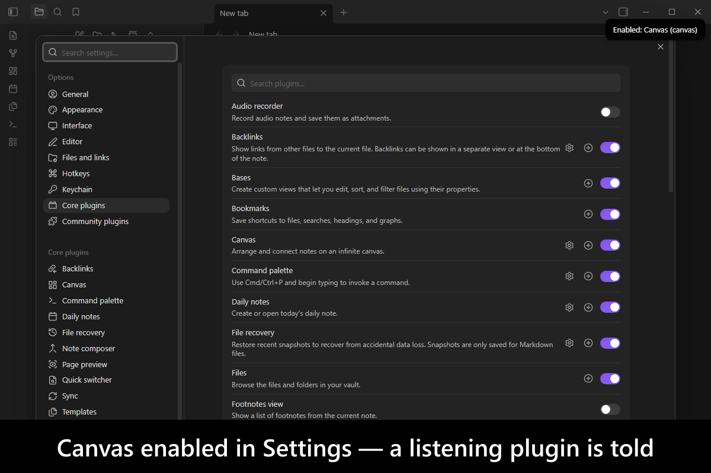
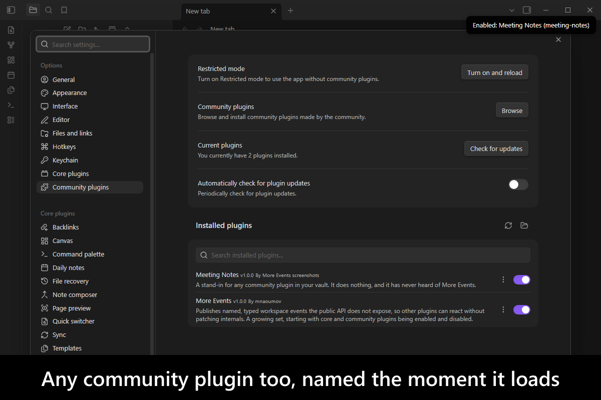
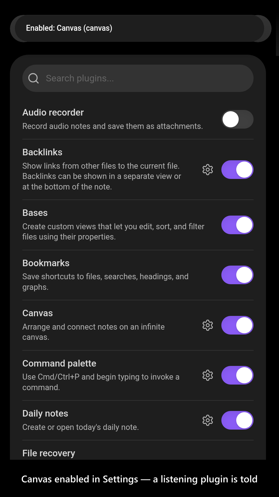
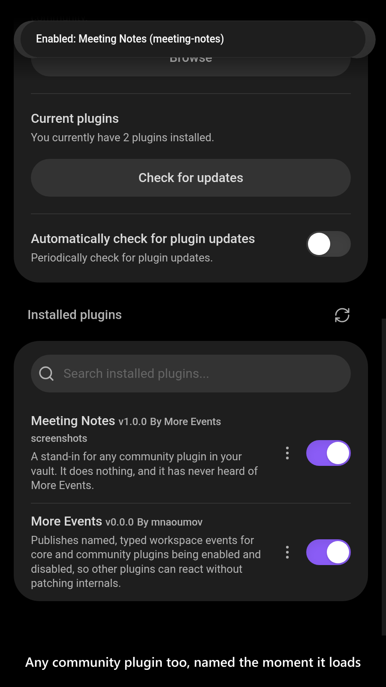

# More Events

[](https://www.buymeacoffee.com/mnaoumov) [](https://github.com/mnaoumov/obsidian-more-events/releases) [](https://github.com/mnaoumov/obsidian-more-events/releases) [](https://github.com/mnaoumov/obsidian-more-events)

**A home for the events [Obsidian](https://obsidian.md/) does not publish.** `More Events` publishes them on `app.workspace`, named, typed and per subject, so any plugin can subscribe with no dependency beyond `obsidian` itself.

Without it, a plugin that needs such an event reads undocumented internals or patches a shared prototype, and two plugins doing that in one vault means two patches on one prototype. This plugin patches once, for everybody. The first set of events is plugin lifecycle, the second is context menus, and more sets follow under the same contract. It has no user interface: the screenshots show another plugin reacting to its events.

<!-- markdownlint-disable MD033 -->

<a href="https://github.com/mnaoumov/obsidian-more-events/blob/HEAD/images/screenshots/screenshot-desktop-1.png"></a>

<details>
<summary>More screenshots</summary>

<div>
<a href="https://github.com/mnaoumov/obsidian-more-events/blob/HEAD/images/screenshots/screenshot-desktop-2.png"></a>
<a href="https://github.com/mnaoumov/obsidian-more-events/blob/HEAD/images/screenshots/screenshot-mobile-1.png"></a>
<a href="https://github.com/mnaoumov/obsidian-more-events/blob/HEAD/images/screenshots/screenshot-mobile-2.png"></a>
</div>

</details>

<!-- markdownlint-enable MD033 -->

## Demo vault

**The documentation is a demo vault.** Its notes explain what the events are and when they fire, with buttons that subscribe to them live so you can toggle a plugin in Settings and watch them arrive.

**[Start reading here](<./demo-vault/00 Start.md>)** — it is plain markdown, so it works on GitHub with nothing installed.

A copy of the vault ships with every release. You can access it via any of the following:

1. Running the **`More Events`: Open demo vault** command.
2. Downloading `more-events-demo-vault.zip` from the [Releases](https://github.com/mnaoumov/obsidian-more-events/releases). It unzips into a single `more-events-demo-vault-<version>` folder.
3. Browsing its source in [`demo-vault/`](./demo-vault/README.md) in this repository.

## What it does

Every event fires on `app.workspace`.

1. **Plugin lifecycle events**, for example `more-events:core-plugin-enabled`: see [01 Core plugin events](<./demo-vault/01 Core plugin events.md>) and [02 Community plugin events](<./demo-vault/02 Community plugin events.md>).
2. **Context menu events**, for example `more-events:all-properties-menu`, so listeners can add items before a menu opens: see [04 Context menu events](<./demo-vault/04 Context menu events.md>).

## See also

[My other Obsidian resources](https://github.com/mnaoumov/obsidian-resources)

No similar plugin was found when this was last searched for, on 2026-10-26.

## For plugin developers

The events and the API are declared in [`api.d.ts`](./api.d.ts), which imports nothing but `obsidian`. The events need no API handle: copy the declarations into your project, or hardcode the names, and subscribe:

```ts
this.registerEvent(
  this.app.workspace.on('more-events:core-plugin-enabled', ({ corePluginId, corePluginName, isUserInitiated }) => {
    if (isUserInitiated) {
      console.log(`${corePluginName} (${corePluginId}) is back, because someone turned it back on`);
    }
  })
);

this.registerEvent(
  this.app.workspace.on('more-events:bookmarks-menu', (menu, bookmarks) => {
    menu.addItem((item) => {
      item.setTitle(`Log ${bookmarks.length} bookmark(s)`).onClick(() => {
        console.log(bookmarks.map((bookmark) => bookmark.path ?? bookmark.title));
      });
    });
  })
);
```

For the current state, and to know whether `More Events` is installed at all, take the API through the registry. The contract is **`1.5.0`** and moves independently of the plugin's own version, so ask for a range.

Beside `api.d.ts`, [`api-contract.ts`](./api-contract.ts) holds the API's contract, `MORE_EVENTS_API_CONTRACT`: for every method, a schema over its arguments and a schema over what it returns. Copy it next to `api.d.ts` and pass it as the `contract`, so both sides check the same definition. It imports from one package besides `./api.d.ts`, [`@mnaoumov/typescript-lib`](https://www.npmjs.com/package/@mnaoumov/typescript-lib) (`1.3.0` or later). More in [03 For plugin developers](<./demo-vault/03 For plugin developers.md>).

```ts
import { watchPluginApi } from '@mnaoumov/obsidian-lib/plugin/plugin-api';

import type { MoreEventsApi } from './api.d.ts';

import { MORE_EVENTS_API_CONTRACT } from './api-contract.ts';

const moreEventsApiRef = watchPluginApi<MoreEventsApi>({
  apiVersionRange: '^1',
  app: this.app,
  component: this,
  contract: MORE_EVENTS_API_CONTRACT,
  pluginId: 'more-events'
});

// `value` is always current and never stale: it is `null` while `More Events` is not loaded, and becomes
// non-`null` on its own when it is.
const moreEventsApi = moreEventsApiRef.value;
if (moreEventsApi) {
  console.log(moreEventsApi.getEnabledCorePluginIds());
  console.log(moreEventsApi.isCorePluginEnabled('backlink'));
  console.log(moreEventsApi.getEnabledCommunityPluginIds());
  console.log(moreEventsApi.isCommunityPluginEnabled('dataview'));
}
```

If you would rather not depend on [`@mnaoumov/obsidian-lib`](https://www.npmjs.com/package/@mnaoumov/obsidian-lib) for that, the registry is a documented wire protocol you can read directly — see [Cross-plugin APIs](https://mnaoumov.dev/obsidian-lib/guides/cross-plugin-apis/).

## Installation

The plugin is available in [the official Community Plugins repository](https://community.obsidian.md/plugins/more-events).

### Beta versions

To install the latest beta release of this plugin (regardless if it is available in [the official Community Plugins repository](https://community.obsidian.md) or not), follow these steps:

1. Ensure you have the [BRAT plugin](https://community.obsidian.md/plugins/obsidian42-brat) installed and enabled.
2. Click [Install via BRAT](https://intradeus.github.io/http-protocol-redirector?r=obsidian://brat?plugin=https://github.com/mnaoumov/obsidian-more-events).
3. An Obsidian pop-up window should appear. In the window, click the `Add plugin` button once and wait a few seconds for the plugin to install.

## Debugging

By default, debug messages for this plugin (id: `more-events`) are hidden.

If you need to enable them refer to the [documentation](https://mnaoumov.dev/obsidian-lib/guides/debugging/).

## Changelog

All notable changes to this project will be documented in the [CHANGELOG](./CHANGELOG.md).

## Contributing

Contributions are welcome — see [CONTRIBUTING](./CONTRIBUTING.md) to get set up.

## Support

<!-- markdownlint-disable MD033 -->

<a href="https://www.buymeacoffee.com/mnaoumov" target="_blank"></a>

<!-- markdownlint-enable MD033 -->

### Filing an issue (for AI agents and humans)

Open issues through the [issue forms](https://github.com/mnaoumov/obsidian-more-events/issues/new/choose), not as blank issues.

To report a bug from inside Obsidian, run the **`More Events`: Report a bug** command. It opens the bug form with the plugin version, the Obsidian version and your operating system already filled in.

Filing from the CLI or the API (`gh issue create --body`, or an AI agent filing for you) skips the form, and `gh issue create --template` cannot load an issue form. In that case, open the matching form in [`.github/ISSUE_TEMPLATE/`](https://github.com/mnaoumov/obsidian-more-events/tree/HEAD/.github/ISSUE_TEMPLATE), copy every field as a `### <label>` heading in the form's order, and fill in each one. Always state the plugin version, the Obsidian version and your operating system.

## License

© [Michael Naumov](https://github.com/mnaoumov/)
